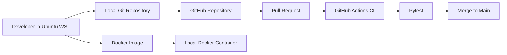
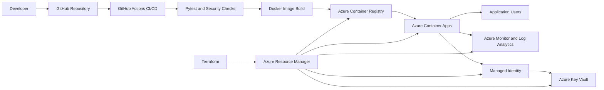

# CloudOps Azure Architecture

## 1. Project Goal

Build, test, package, secure, deploy, monitor, and operate a
containerized Python Flask application using DevOps practices.

The project is being developed locally first so that Azure
trial time and cloud costs are not wasted on basic setup or
local troubleshooting.

## 2. Current Application

Application: CloudOps Dashboard

Technology:

- Python
- Flask
- Pytest
- Docker
- Git
- GitHub
- GitHub Actions

Endpoints:

- `/`
- `/health`
- `/api/info`
- `/api/version`

## 3. Current Local Delivery Flow



## 4. Planned Azure Architecture



## 5. Planned Azure Resources

| Resource | Proposed name | Purpose |
|---|---|---|
| Resource group | `rg-cloudops-dev` | Hold development resources |
| Container Registry | `acrcloudops<unique>` | Store Docker images |
| Container Apps environment | `cae-cloudops-dev` | Container Apps runtime boundary |
| Container App | `ca-cloudops-api-dev` | Run the Flask application |
| Key Vault | `kv-cloudops-<unique>` | Store protected configuration |
| Log Analytics workspace | `log-cloudops-dev` | Store and query logs |
| Managed identity | `id-cloudops-dev` | Passwordless Azure authentication |

Actual names will be validated against Azure naming rules
before resource creation.

## 6. Resource Hierarchy

```text
Microsoft Entra tenant
 |
 +-- Azure subscription
 |
 +-- rg-cloudops-dev
 |
 +-- Container Registry
 +-- Container Apps environment
 +-- Container App
 +-- Key Vault
 +-- Log Analytics workspace
 +-- Managed identity
```

## 7. Environment Strategy

Initial environments:

- Local development
- Local staging
- Azure development

Possible later environments:

- Azure staging
- Azure production

The first Azure deployment will use only a development
environment.

## 8. Image Delivery Flow

```text
Application source
 |
 +-- Run pytest
 |
 +-- Run security checks
 |
 +-- Build Docker image
 |
 +-- Tag image with version
 |
 +-- Push image to registry
 |
 +-- Deploy selected image
 |
 +-- Run health and smoke tests
```

## 9. Planned Image Tags

Examples:

```text
cloudops-dashboard:1.0.0
cloudops-dashboard:1.1.0
cloudops-dashboard:commit-sha
```

A versioned image will be used for deployments rather than
depending only on the mutable `latest` tag.

## 10. Naming Standard

Proposed structure:

```text
<resource-type>-<project>-<environment>
```

Examples:

```text
rg-cloudops-dev
cae-cloudops-dev
ca-cloudops-api-dev
log-cloudops-dev
id-cloudops-dev
```

Some Azure services have special naming restrictions and
global uniqueness requirements. Those names will be finalized
only during the Azure deployment phase.

## 11. Tagging Standard

Planned tags:

| Tag | Value |
|---|---|
| `project` | `cloudops` |
| `environment` | `dev` |
| `owner` | `javed` |
| `managed-by` | `terraform` |
| `purpose` | `learning` |

## 12. Security Principles

- Do not commit passwords, tokens, or keys.
- Use least-privilege access.
- Use managed identity where supported.
- Store protected values in Azure Key Vault.
- Run the container as a non-root user.
- Scan Python dependencies.
- Scan the Docker image.
- Require CI checks before merging.
- Keep development and production configuration separate.
- Do not use a client or employer production subscription.

## 13. Reliability Principles

- Provide a `/health` endpoint.
- Run automated tests before deployment.
- Use immutable and versioned images.
- Keep the previous working image available.
- Run smoke tests after deployment.
- Document rollback procedures.
- Use Infrastructure as Code for repeatable deployments.

## 14. Monitoring Principles

Planned monitoring:

- Application logs
- Container startup logs
- HTTP failures
- Health-check failures
- Deployment events
- Resource metrics
- Alerts for important failures

## 15. Cost-Safety Principles

- Develop and troubleshoot locally first.
- Do not activate the Azure trial until deployment is ready.
- Keep the Azure spending limit enabled.
- Do not upgrade to pay-as-you-go.
- Configure budget alerts before creating resources.
- Use one development resource group.
- Avoid premium and dedicated services.
- Keep resource sizes small.
- Use scale-to-zero where appropriate.
- Delete resources after experiments.
- Verify that the resource group has been deleted.
- Preserve project evidence in GitHub rather than keeping
 resources permanently online.

## 16. Infrastructure as Code Plan

Terraform will eventually manage:

- Resource group
- Azure Container Registry
- Container Apps environment
- Container App
- Managed identity
- Key Vault
- Log Analytics workspace
- Relevant role assignments

Before Azure activation, Terraform will be learned and tested
locally without creating Azure resources.

## 17. Deployment Phases

### Phase 1 — Local

- Build Flask application
- Run automated tests
- Build Docker image
- Run containers
- Implement CI
- Add security scanning
- Add monitoring
- Test deployment and rollback locally

### Phase 2 — Azure

- Activate protected Azure trial
- Verify spending limit
- Configure budgets and alerts
- Create development resource group
- Provision infrastructure through Terraform
- Push image to Azure Container Registry
- Deploy to Azure Container Apps
- Configure managed identity and Key Vault
- Configure monitoring
- Test rollback
- Destroy all resources

## 18. Current Project Status

Completed:

- Ubuntu WSL environment
- Git and GitHub repository
- Flask application
- Four application endpoints
- Five automated tests
- Docker image
- Development and staging containers
- Git branching
- Pull requests
- GitHub Actions CI

Current Day 5 work:

- Azure fundamentals
- Azure architecture
- Naming and tagging plan
- Cost-safety plan
- Azure CLI local installation

Planned next:

- Terraform fundamentals using local resources